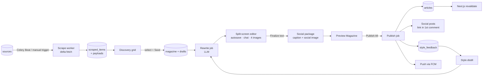
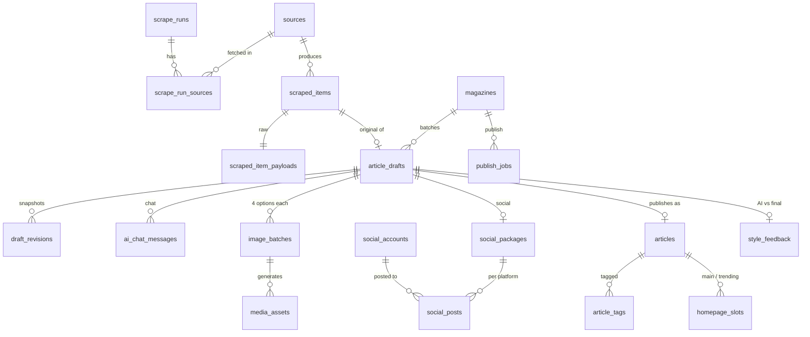

# BIFOR NEW'S: System Architecture (v0.1)

Scope of this document: the data model and backend behind the
**Scraper → AI Editor → Social Publishing** workflow, plus the public read API that the
Next.js site and the mobile app consume.

- Full DDL: [`db/schema.sql`](../db/schema.sql)
- Route list: [`docs/API.md`](API.md)

---

## 1. Stack decisions

| Layer | Choice | Why |
|---|---|---|
| API | **Python 3.12 + FastAPI**, SQLAlchemy 2, Alembic | Scraping and AI SDKs are strongest in Python; async I/O suits many slow outbound calls |
| Background work | **Celery + Redis** (Celery Beat for scheduled scrapes) | Scrapes, AI calls, image generation and social posting are all slow and retryable, so none of them run inside an HTTP request |
| Database | **PostgreSQL 16 only** | Raw scraped JSON goes into a `jsonb` table (`scraped_item_payloads`). One database means one backup and transactional dedup. MongoDB adds operations work without adding capability at this scale |
| Scraping | `httpx` + `selectolax` for static pages, **Playwright** for JS-rendered pages, `feedparser` for RSS, `trafilatura` as the generic extractor for Manual Entry by URL | Cheapest method per source; the developer picks it per source |
| Files | S3-compatible storage (Cloudflare R2) behind a CDN; `pyvips` for resizing to WebP/AVIF | Image pipeline produces fixed renditions (see §6) |
| Public site | **Next.js (App Router) + Tailwind**, `next/image` | Use **ISR with on-demand revalidation by tag** rather than rendering on every request. Pages are still server-rendered HTML for SEO, but served from cache and refreshed the moment something is published |
| CMS | Separate Next.js app, **TipTap** (ProseMirror) for the canvas | TipTap JSON gives structured paragraphs for diffing and AI "fix this paragraph" |
| Mobile | **Expo (React Native)** | Native push, universal/app links and offline storage. A PWA is weak on iOS push and deep links |
| Realtime | Server-Sent Events | Job progress (scrape, AI, images, publish) and streaming AI chat. One-way is enough |
| LLM / images | Provider-agnostic wrappers: `LLMProvider` (OpenAI and Anthropic implementations) and `ImageProvider` | Model IDs live in config, so switching provider is a config change |

### Proposed repo layout

```
bifor-news/
  apps/web/        Next.js public site
  apps/admin/      Next.js CMS
  apps/mobile/     Expo app
  services/api/    FastAPI (routers: public, admin, auth, webhooks)
  services/workers/  Celery tasks: scrape, ai, images, social, publish, push
  packages/ui/     shared Tailwind preset + brand tokens
  db/              schema.sql -> Alembic migrations
  docs/
```

---

## 2. The pipeline at a glance



### Entity relationships (core)



---

## 3. State machines

**Source** (Source Management tab)

```
pending_dev ──dev saves selectors──> in_development ──dry run passes + approve──> active
active ──3 consecutive failures──> broken ──dev fixes + approve──> active
active <──> paused          any ──> archived
```
Adding a source (name + URL) creates it as `pending_dev` and notifies users with the
`developer` role. Approval requires a successful dry run in the last 24 hours (`last_test_passed_at`).

**Draft** (one article in the editor)

```
queued_ai -> ai_processing -> editing -> text_final -> ready -> published
                    \-> ai_failed (retry)        any -> skipped
```
- `text_final`: the text is locked and the social module unlocks.
- `ready`: requires category, hero image, finalized text and an approved social package. The
  database enforces the first three (`ready_means_complete`).
- Reopening the text sends the draft back to `editing` and marks the social package `is_stale`.

**Magazine** colors in the Saved Drafts tab: `draft` grey · `editing` amber · `ready` green ·
`publishing` blue · `published` dark · `partially_failed` red · `archived` faded.
Status is derived from the drafts inside it and recalculated after every draft transition.

---

## 4. Discovery: delta fetch

Goal: each run fetches only what was published since the last **successful** run of that source.

```
for each active source (parallel, max 2 concurrent requests per domain):
    since = source.watermark_published_at  or  now() - 24h on the first run
    walk list pages / RSS newest-first
        keep items with published_at > since - 10 min      (overlap absorbs clock skew)
        stop paging once a whole page is older than since
    for each candidate:
        url_hash = sha256(canonical_url)     # strip utm_*, fragments, trailing slash
        INSERT ... ON CONFLICT (url_hash) DO NOTHING      # dedup safety net
        fetch the article page, extract with selector_config
        content_hash = sha256(normalized body)  -> flags the same story under a second URL
        category = URL-path rule from selector_config, else source default, else a cheap LLM classify
    success: commit new watermark = max(published_at seen); consecutive_failures = 0
    failure: keep the old watermark (the next run refetches the gap); consecutive_failures += 1
```

The watermark is the main mechanism and `url_hash` is the safety net, so a source with
unreliable dates still produces no duplicates.

**History logs** read `scrape_runs` + `scrape_run_sources`. "Pull an old article into the current
magazine" is `POST /admin/magazines/{id}/drafts` with any `scraped_item_id`. A partial unique index
stops one item from being live in two magazines.

### Selector config (written by the developer, stored in `sources.selector_config`)

```json
{
  "list": {
    "urls": ["https://example.co.il/economy"],
    "item": "article.teaser",
    "link": "a.headline@href",
    "published_at": "time@datetime",
    "next_page": "a.pagination-next@href",
    "max_pages": 3
  },
  "article": {
    "title": "h1",
    "intro": ".article-subtitle",
    "body": ".article-body > p",
    "image": "meta[property='og:image']@content",
    "published_at": "meta[property='article:published_time']@content",
    "remove": [".ad-slot", ".related-articles"]
  },
  "category_rules": [{ "url_contains": "/real-estate/", "category": "real-estate" }],
  "requires_js": false
}
```

---

## 5. The split-screen editor

### Rewrite job (runs as soon as the magazine is saved)

Prompt assembly, in order:
1. `rewrite.system`: the active version from `prompt_templates` (seeded with the spec's prompt plus guardrails).
2. `{{style_rules}}` ← the active `style_profiles.rules`.
3. Two or three few-shot pairs (AI text → editor's final) from `style_feedback`, same category, most recent.
4. The original title, intro and body inside `<source_article>` tags. Scraped HTML is
   **untrusted input**: a page can contain text written to manipulate the model, so it is
   fenced and the prompt says to ignore instructions inside it.

The output is JSON (title, subtitle, paragraphs, suggested category/tags, `image_prompt`). It is stored as
both the canvas content and the frozen **AI baseline** (`ai_baseline_*`), which the learning loop
compares against later. `image_prompt` then starts the first image batch, so the editor opens with
text and 4 images already prepared.

### Autosave protocol

- Client: debounce 1.5 s after typing stops, forced save every 10 s during continuous typing,
  plus a local IndexedDB copy for offline or crash recovery.
- `PATCH /admin/drafts/{id}` with `version`. Server runs
  `UPDATE ... SET ..., version = version + 1 WHERE id = $1 AND version = $2`. If no row matches,
  it returns **409** with the server copy, and the client shows a merge prompt.
- A `draft_revisions` snapshot is written at most once a minute, and always on AI changes, restore and finalize.
- An edit lock (60 s, renewed by heartbeat) prevents two editors working on the same draft unknowingly.

### AI chat ("make it shorter", "fix this paragraph")

`POST /admin/drafts/{id}/chat` streams over SSE. If a selection is sent, only those paragraphs are
rewritten. The result is applied to the canvas as a new revision (`ai_refine`), and the chat message links
to that revision for one-click undo. Chat edits never change the AI baseline.

### Images (4 options)

`ImageProvider.generate(prompt, n=4, aspect="16:9")`. Providers that return one image per call
(DALL·E 3 does) get 4 parallel calls. Each click creates an `image_batches` row, so earlier batches
stay visible. The selected image becomes `hero_media_id`. AI images are stored with
`is_ai_generated = true` and the credit line "איור: בינה מלאכותית".

Midjourney has had no official public API. Confirm before relying on it. The wrapper keeps that decision open.

---

## 6. Image pipeline (Manual Entry and every stored image)

All images are normalized on ingest to the site standard. Store the master once, then render:

| Rendition | Size | Used by |
|---|---|---|
| `hero` | 1600×900 (16:9) | article page, homepage lead |
| `card` | 640×360 | grids, trending |
| `thumb` | 160×160 | lists, related |
| `og` | 1200×630 | Open Graph / link previews |
| `feed` | 1080×1350 (4:5) | Instagram / Facebook feed (social image only) |
| `story` | 1080×1920 (9:16) | Stories, WhatsApp/Telegram (social image only) |

Crops follow a focal point (`focal_x/y`) the editor can drag. The output is WebP and AVIF with EXIF
stripped. Images under 1200 px wide are rejected for hero use with a clear message.

---

## 7. Social distribution

Unlocked only at `text_final`, so no tokens are spent on text that will change.
`POST /admin/drafts/{id}/social/generate` produces the 2-sentence caption and a **separate** AI image
(prompted for social: bold, high contrast, no text in the image). Both can be edited or regenerated independently.

Payload builders (one per platform, all reading the same package):

| Platform | Post | Where the link goes |
|---|---|---|
| Facebook Page | photo + caption | **first comment** |
| Instagram (Business) | feed image + caption, optional Story | **first comment** (feed); stories carry no link |
| X | post with media | **first reply** (X's equivalent of a first comment) |
| Telegram channel | `sendPhoto`, caption + link | in the caption |
| WhatsApp | prepared text + link + image | in the text |
| TikTok | photo post (feature-flagged) | profile link / caption |

All links carry `utm_source=<platform>&utm_medium=social` and use the `/a/{id}` short path, which the
mobile app claims as a universal/app link (deep linking).

Points to confirm with each platform before building, because their API terms change:
- **WhatsApp:** I know of no official API for posting to WhatsApp Channels. The Business API sends
  template messages to opted-in users. v1 prepares the payload for one-tap manual sharing.
- **X:** posting via the API requires a paid tier.
- **TikTok:** the Content Posting API requires an app audit.
- **Instagram:** requires a Business or Creator account linked to a Facebook Page, and the image at a public URL.

Platform tokens live in a secrets manager (`social_accounts.secret_ref`), never in the database.

---

## 8. Publish All

`POST /admin/magazines/{id}/publish` (with `Idempotency-Key`) creates a `publish_jobs` row and
runs the following steps. Each step is recorded in `publish_jobs.steps` and can be retried on its own:

1. **Validate:** every non-skipped draft is `ready`; otherwise the request returns 422 with a per-draft checklist.
2. **Commit articles** (one DB transaction): insert `articles` (sanitized HTML), resolve tags, shift
   `homepage_slots` (new main article to position 1, 7 slots; trending capped at 14; pinned slots stay),
   set drafts to `published`.
3. **Revalidate** Next.js tags (`home`, `category:<slug>`, `article:<id>`) and purge the CDN.
4. **Social:** one Celery task per enabled `social_posts` row: post, then the first comment with the
   link. A failed comment gets status `comment_failed` (retryable) and the post is not deleted.
   Social failures never roll back step 2.
5. **Learning loop:** write `style_feedback` rows (see §9).
6. **Push:** for drafts with `send_push`, FCM topic `breaking` with deep link `/a/{id}`.
7. Magazine becomes `published`, or `partially_failed` with the failing items listed on the dashboard.

---

## 9. The learning loop

A hosted LLM does not learn from an API call. Every request is stateless, so sending a diff once
changes nothing. To make the AI improve, the system keeps the edits and feeds them back in four layers:

1. **Capture (every publish):** `style_feedback` stores the AI baseline, the final text, a unified
   diff and an `edit_ratio` (0 = published as-is, 1 = fully rewritten).
2. **Few-shot examples (from day one):** each rewrite prompt includes 2–3 recent baseline→final pairs
   from the same category.
3. **Distillation (nightly, or every 20 new rows):** a `style_distill` job gives the LLM the batch of
   diffs and the current rules and asks it to update the house-style guide ("short sentences, active
   voice, no 'כאמור', numbers as digits…"). The result is a new `style_profiles` version that an admin
   can review, activate or roll back.
4. **Fine-tuning (optional, later):** once there are a few hundred good pairs, export
   them as JSONL to a provider that supports fine-tuning and switch the model ID in config.

**How you know it works:** the dashboard charts the average `edit_ratio` per week. It should go down.

---

## 10. Security and editorial notes

- Sanitize all scraped HTML (`nh3`) before it reaches the admin UI or the public site.
- Respect each source's `robots.txt` and terms. Keep attribution (`articles.source_id`, `source_url`).
  Do not republish source images; the AI-image flow already avoids this. Have a lawyer review
  the rewrite-and-publish model before launch.
- Roles: `admin` (everything), `editor` (content and publishing), `developer` (selectors, approve sources),
  `viewer` (read-only).
- Every status change goes to `audit_log`.

## 11. Decisions still open

1. LLM provider and model for rewrite and chat (wrapper ready for OpenAI or Anthropic).
2. Image provider (must support 16:9 and 9:16, or crop well from square).
3. Domain name (used in deep links and UTM).
4. Market data provider for the "בורסה ומדדים" ticker.
5. WhatsApp approach: manual share vs. Business API broadcast list.
